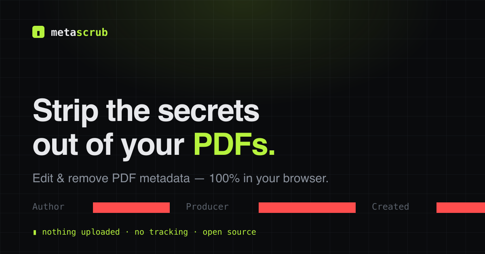

# MetaScrub

**Edit & strip PDF metadata — 100% in your browser. Nothing uploaded, ever.**

[](https://astro.build)
[](https://svelte.dev)
[](https://tailwindcss.com)
[](#license)
[](#why-it-exists)

MetaScrub reads, edits, and removes the hidden metadata inside PDF files — Author, Title, software fingerprints, timestamps, and the embedded XMP packet. Every byte is processed locally in the browser tab. There is no server, no upload, and no account.



---

## Why it exists

Most "online PDF tool" sites upload your file to a server to process it — even the ones marketed as private. That's a non-starter for a résumé, a legal filing, or any confidential document. MetaScrub's architecture removes the problem entirely: the PDF engine runs as client-side JavaScript, so the file never leaves your device. You can disconnect from the internet after the page loads and it still works. Even the web fonts are self-hosted, so the site makes **zero third-party network calls**. The page's Content-Security-Policy (`connect-src 'none'`) blocks every network request, so the browser itself enforces that nothing is uploaded.

## Features

- **Inspect** — see every Info-dictionary *and* XMP field hiding in a PDF.
- **Edit** — rewrite Title, Author, Subject, Keywords, Creator, Producer; changes are written to both the Info dictionary and XMP, kept in sync.
- **Scrub** — in one click, remove the Info dictionary (custom fields like Company included), every XMP packet, app-private data, comment authors and timestamps, and metadata left over from earlier saves, with a report of exactly what was removed.
- **Batch** — drop many files; edit or scrub them all and download as a zip.
- **Private by construction** — no uploads, no tracking, no accounts. Works offline.

## How it works

```
Static Astro pages             ─┬─→  /  /edit  /scrub  /blog/*   →  fast, SEO-friendly
                                └─→  one Svelte island (client:load)  →  all PDF work runs in-browser
```

The blog pages ship no JavaScript. The tool is a single hydrated [Svelte](https://svelte.dev) island, on the home page and on `/scrub` and `/edit`, that calls a small, framework-agnostic engine built on [`pdf-lib`](https://pdf-lib.js.org). The engine loads when the page is idle, not during hydration.

### Engineering notes

A few PDF-specific problems this handles that off-the-shelf tools often get wrong:

- **XMP, not just the Info dictionary.** `pdf-lib` has no first-class XMP API, so the engine reads/writes the catalog's `/Metadata` stream directly. Tools that only clear the Info dictionary leave a second copy of your name in the XMP packet.
- **A scrub that actually scrubs.** Loading with `{ updateMetadata: false }` stops `pdf-lib` re-stamping Producer/ModDate on save. `pdf-lib` also keeps and re-saves objects nothing points to any more, such as the Info dict from an earlier incremental save, so the engine drops every unreachable object before writing. Comment authors are stripped from every annotation in the file, not just those listed on a page: macOS PDFKit writes a second copy of each note that only its popup links to.
- **Tests that can see a leak.** A raw-byte search misses most leaks, because `pdf-lib` writes Info values as UTF-16 hex and packs dictionaries into compressed object streams. The suite's `deepText` helper re-parses the output and decodes every string and stream before asserting, and runs against real Chrome and macOS PDFKit output as well as synthetic files.
- **The keywords delimiter problem.** PDF's `Keywords` field has no standard separator; the authoritative keyword list is taken from the XMP `dc:subject` bag where available.

## Tech stack

| | |
|---|---|
| Framework | Astro 7 (islands + content collections) |
| Tool UI | Svelte 5 |
| Styling | Tailwind CSS 4 |
| PDF engine | pdf-lib |
| Zip (batch) | client-zip |
| Tests | Vitest |
| Hosting | Static, on Vercel (works on any CDN) |

## Local development

```bash
npm install
npm run dev        # http://localhost:4321
npm run build      # static output to dist/
npm run preview    # serve the built site
npm test           # engine unit tests
npm run typecheck  # tsc --noEmit
```

## Project structure

```
src/
  lib/            # framework-agnostic engine (pure, unit-tested)
    pdf-meta.ts   #   read/write Info dictionary + XMP
    xmp.ts        #   XMP packet build/parse/read/write
    scrub.ts      #   wipe + removal report
    batch.ts      #   apply edit/scrub across many files
    download.ts   #   browser download + zip helpers
  components/     # Svelte island + Astro UI
  pages/          # /, /edit, /scrub, /blog
  content/blog/   # markdown posts
tests/            # Vitest engine suite + real-generator PDF fixtures
docs/             # implementation plan + progress
```

## Author

Built by **Mujahid Abbas**

- Website — [mujahidabbas.dev](https://mujahidabbas.dev/)
- GitHub — [@MujahidAbbas](https://github.com/MujahidAbbas)

If MetaScrub saved you a bit of hassle, you can [buy me a coffee ☕](https://ko-fi.com/mujahiddev).

## License

[MIT](LICENSE) © Mujahid Abbas
